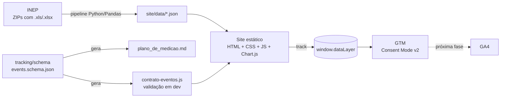

# EduTrackBrasil

**Como está a educação no seu município?** Busque qualquer um dos 5.571 municípios do Brasil e veja aprovação, reprovação, abandono e IDEB, com a evolução de 2007 a 2025 e a comparação com a média do estado e do Brasil. No fim, gere um cartão-resumo para compartilhar.

Dados oficiais do INEP. Site estático (HTML, CSS e JavaScript puro), instrumentado com `dataLayer`, Google Tag Manager e Consent Mode v2, e com um plano de medição versionado como código.

**🌐 Site:** <https://diegosousaoliveira.github.io/EduTrackBrasil/>

> 🚧 Em desenvolvimento. O GTM já está instalado, com consentimento. As tags do GA4 são a próxima fase.

## O problema

Os dados educacionais do INEP são públicos, mas estão espalhados em dezenas de planilhas com formatos que mudam a cada ano. Para um professor, gestor ou mãe/pai, descobrir "a aprovação da escola pública da minha cidade melhorou?" exige baixar ZIPs, achar a linha certa e comparar à mão.

O EduTrackBrasil resolve isso em uma busca. E, como projeto de portfólio de **Web Analytics**, mostra a outra metade: como medir o uso do site com um tracking documentado, testado e auditável.

## Arquitetura



| Pasta | O que tem |
| --- | --- |
| `pipeline/` | Leitura dos ZIPs do INEP, transformação para formato longo, exportação dos JSONs, relatório de qualidade e testes |
| `site/` | O site: `index.html`, `css/`, `js/` (módulos ES, sem build) e `data/` (JSONs gerados) |
| `tracking/` | Contrato de eventos (JSON Schema), gerador da documentação e testes do contrato |
| `docs/` | [Inspeção dos dados brutos](docs/inspecao_dados.md) e [relatório de qualidade](docs/relatorio_qualidade.md) (gerado) |
| `data/raw/` | Arquivos originais do INEP (**fora do Git**; veja como baixar abaixo) |

### Dados

- **Taxas de Rendimento Escolar** (INEP, Censo Escolar 2007–2025): por município e as médias oficiais de Brasil e UFs.
- **Ideb 2025** (INEP): municípios (anos iniciais, anos finais, ensino médio), UFs e Brasil, com a série histórica desde 2005.
- Chave de tudo: **código IBGE do município** (7 dígitos, como texto), nunca o nome.
- As médias do estado e do Brasil são as **oficiais** do INEP, não calculadas a partir dos municípios.

### Qualidade de dados: o que as planilhas escondiam

Detalhes em [docs/inspecao_dados.md](docs/inspecao_dados.md). Os principais:

- A **ordem das colunas muda** entre 2010 e 2011. O pipeline acha cada coluna pelo texto do cabeçalho e para com erro se alguma faltar ou aparecer duas vezes.
- Em 2020, a **linha de códigos internos está desalinhada** das colunas reais. O pipeline a ignora.
- Valores ausentes em vários formatos (`--`, `-`, `ND`, `ND*`), floats como `73.09999999999998`, UFs abreviadas ("R. G. do Norte"), coluna duplicada no arquivo do IDEB.
- Validações a cada execução: md5 dos 62 arquivos, aprovação + reprovação + abandono = 100, faixas 0–100 e 0–10, municípios criados depois de 2007. Resultado em [docs/relatorio_qualidade.md](docs/relatorio_qualidade.md).

### Tracking

O plano de medição é **código**: [`tracking/schema/events.schema.json`](tracking/schema/events.schema.json) é a fonte da verdade, e a documentação ([`tracking/docs/plano_de_medicao.md`](tracking/docs/plano_de_medicao.md)) é gerada a partir dele.

| Evento | Tipo | Quando |
| --- | --- | --- |
| `search` | recomendado GA4 | busca confirmada (inclusive sem resultado) |
| `select_content` | recomendado GA4 | escolha de um município |
| `view_chart` | personalizado | gráfico ≥ 50% visível, 1x por gráfico e município |
| `change_filter` | personalizado | troca de etapa, rede ou indicador |
| `compare_toggle` | personalizado | liga/desliga comparação com estado e Brasil |
| `generate_card` | personalizado | cartão-resumo gerado |
| `share` ⭐ | recomendado GA4 | cartão compartilhado (evento-chave) |
| `data_unavailable` | personalizado | IDEB não divulgado ou etapa sem dados |
| `consent_update` | personalizado | escolha no banner de cookies (aceitar ou recusar) |

- Todo evento passa por `track()` ([`site/js/track.js`](site/js/track.js)), que envia `event_id` (UUID) e `schema_version`, e limpa os parâmetros do evento anterior (o modelo de dados do GTM é persistente).
- Em ambiente local, cada push aparece no console e é **validado contra o contrato**. Violações (nome em camelCase, parâmetro faltando, código IBGE como número) viram `console.warn`.
- Os testes conferem os limites do GA4 (nomes ≤ 40 caracteres, ≤ 25 parâmetros, valores ≤ 100), se o contrato rejeita inconsistências típicas e se todo evento do contrato está implementado no site.

### Privacidade e consentimento

- **Consent Mode v2** com os quatro sinais em `denied` por padrão, definidos no `<head>` **antes** do GTM (`GTM-K8NTDB7L`), em todas as páginas.
- **Banner** ([`site/js/consentimento.js`](site/js/consentimento.js)) com "Aceitar" e "Recusar" de mesmo destaque. Aceitar envia `gtag('consent','update',{analytics_storage:'granted'})` e o evento `consent_update`. Os sinais de anúncio ficam sempre negados.
- A escolha fica no `localStorage` e é reaplicada no `<head>` a cada visita, antes do GTM carregar. O link **"Preferências de privacidade"** no rodapé reabre o banner, e recusar depois de aceitar apaga os cookies `_ga`.
- [Política de privacidade](site/privacidade.html) curta, com base legal (LGPD, consentimento), cookies, compartilhamento e retenção.
- Os testes garantem que toda página HTML tem o consentimento antes do GTM, o `<noscript>` logo após o `<body>` e o acesso às preferências.

## Como rodar

Requisitos: Python 3.11+ e Git.

### 1. Ambiente

```bash
python -m venv .venv
# Windows
.venv\Scripts\activate
# Linux/macOS
source .venv/bin/activate

pip install -r requirements.txt
```

### 2. Baixar os dados brutos (só para rodar o pipeline)

Os JSONs prontos já estão em `site/data/`, então **para ver o site não é preciso baixar nada**. Para regenerar os dados, coloque os ZIPs do INEP (sem extrair) nestas pastas. Os nomes dos arquivos podem variar, porque o pipeline lê todo `*.zip` de cada pasta.

| Pasta | O que baixar | Onde |
| --- | --- | --- |
| `data/raw/rendimento/municipios/` | "Municípios", de 2007 a 2025 (19 ZIPs) | [Taxas de Rendimento Escolar](https://www.gov.br/inep/pt-br/acesso-a-informacao/dados-abertos/indicadores-educacionais/taxas-de-rendimento-escolar) (uma aba por ano) |
| `data/raw/rendimento/brasil_uf/` | "Brasil, Regiões e UFs", de 2007 a 2025 (19 ZIPs) | mesma página |
| `data/raw/ideb/` | os 5 ZIPs abaixo | [Ideb – Resultados](https://www.gov.br/inep/pt-br/areas-de-atuacao/pesquisas-estatisticas-e-indicadores/ideb/resultados) |

```bash
cd data/raw/ideb
for f in anos_iniciais_municipios anos_finais_municipios ensino_medio_municipios regioes_ufs_ideb brasil_ideb; do
  curl -LO "https://download.inep.gov.br/ideb/resultados/divulgacao_${f}_2025.zip"
done
```

### 3. Pipeline de dados

```bash
python -m pipeline.run
```

Leva cerca de 1,5 minuto. Confere os md5, lê as planilhas direto dos ZIPs, gera `site/data/` (`municipios.json`, `uf/XX.json`, `referencias.json`) e atualiza `docs/relatorio_qualidade.md`.

### 4. Plano de medição

Depois de mudar `tracking/schema/events.schema.json`:

```bash
python -m tracking.gerar             # regenera plano_de_medicao.md e site/js/contrato-eventos.js
python -m tracking.gerar --verificar # só confere se estão atualizados
```

### 5. Testes

```bash
python -m pytest
```

São 94 testes:

- **regras de leitura:** com rótulos reais das planilhas do INEP;
- **contrato dos JSONs:** cerca de 5.570 municípios, códigos de 7 dígitos, sem duplicatas, taxas entre 0 e 100, somas ≈ 100, IDEB coerente;
- **contrato de eventos:** limites do GA4, inconsistências rejeitadas e documentação atualizada;
- **páginas HTML:** Consent Mode antes do GTM, `<noscript>`, banner, preferências e caminhos relativos.

### 6. Ver o site localmente

```bash
cd site
python -m http.server 8000
```

Abra <http://localhost:8000>. Para ir direto a um município, use o código IBGE: <http://localhost:8000/?m=2204600>. Abra o console do navegador (F12) para ver os eventos do `dataLayer`.

> Abrir o `index.html` direto do disco (`file://`) não funciona: o navegador bloqueia o carregamento dos JSONs e dos módulos JS. Use sempre o servidor local.

Todos os caminhos do site são relativos, então ele funciona em subpasta (`diegosousaoliveira.github.io/EduTrackBrasil/`) sem ajustes.

### 7. Publicação

O workflow [`.github/workflows/pages.yml`](.github/workflows/pages.yml) publica a pasta `site/` no GitHub Pages a cada push na `main`. Também dá para rodar à mão em **Actions → Publicar site → Run workflow**. Na primeira vez, é preciso escolher **Settings → Pages → Source: GitHub Actions**.

## Decisões de projeto

- **Sem framework e sem build:** o site carrega rápido no celular e qualquer pessoa entende o código. São módulos ES nativos e Chart.js por CDN com versão fixa e hash SRI.
- **Um JSON por estado:** o celular baixa só o estado escolhido (no pior caso, MG, cerca de 325 KB com gzip).
- **Ano sem dado = `null`:** o gráfico mostra lacuna, nunca zero. 2020 é marcado por causa do salto atípico de aprovação na pandemia.
- **IDEB ausente com motivo:** `nao_divulgado` (o INEP publicou "-") e `sem_registro` (município fora da planilha). Na tela, os dois aparecem como "IDEB não divulgado pelo INEP".
- **IDEB do ensino médio nas UFs usa a rede estadual:** a planilha de UFs não tem a linha "Pública" nessa etapa, e o site deixa isso explícito.

## Próximos passos

- [x] **GTM instalado** (`GTM-K8NTDB7L`) em todas as páginas.
- [ ] **Tags do GA4 no GTM:** tags para os 9 eventos (modo básico: só disparam com `analytics_storage` concedido), dimensões personalizadas registradas e `share` como evento-chave, validados no Tag Assistant e na DebugView.
- [x] **Consent Mode v2 e LGPD:** banner com "Aceitar" e "Recusar" de mesmo destaque, os quatro sinais em `denied` por padrão e uma página de privacidade.
- [x] **Deploy no GitHub Pages:** `.github/workflows/pages.yml` publica `site/` a cada push na `main`.
- [ ] **QA automatizado:** Playwright percorrendo jornadas com o GTM bloqueado, validando cada push contra o JSON Schema, no GitHub Actions.
- [ ] **Reconciliação:** coletor próprio (FastAPI) recebendo os mesmos eventos, para comparar com o GA4 via Data API.
- [ ] **Dashboard** com os dados reais de uso.

## Licença e fonte dos dados

- **Código:** licença MIT (veja [LICENSE](LICENSE)).
- **Dados:** [INEP](https://www.gov.br/inep/) – Taxas de Rendimento Escolar (Censo Escolar) e Índice de Desenvolvimento da Educação Básica (Ideb).

EduTrackBrasil é um projeto independente, sem vínculo com o INEP ou o MEC.
